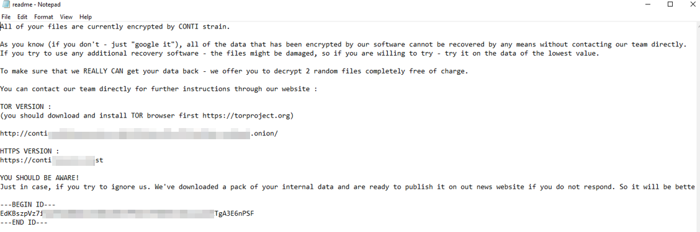

# Practical 1 Report

## Lab 1: Splunk Basics - Did you SIEM?

Splunk is **a powerful data analytics and log management platform used to ingest, index, search, and visualize massive volumes of machine-generated telemetry.**

Splunk has three main components, namely Forwarder, Indexer, and Search Head.

1. What is the attacker IP found attacking and compromising the web server?

- The attacker IP is 198.51.100.55 which was found attacking and compromising the web server. 


#### search query used
```
index=main sourcetype=web_traffic user_agent!=*Mozilla* user_agent!=*Chrome* user_agent!=*Safari* user_agent!=*Firefox*
```

2. Which day was the peak traffic in the logs? (Format: YYYY-MM-DD)
- 2025-10-12 was the peak traffic day in the logs.


#### search query used
```
index=main sourcetype=web_traffic | timechart span=1d count | sort by count | reverse
```

3. What is the count of Havij user_agent events found in the logs?
- The count of Havij user_agent events in the logs is 993


#### search query used
```
index=main sourcetype=web_traffic | timechart span=1d count | sort by count | reverse
```

4. How many path traversal attempts to access sensitive files on the server were observed?

- There were 658 path traversal attempts to access sensitive files on the server.


#### search query used
```
sourcetype=web_traffic client_ip=198.51.100.55 AND path="*..\/..\/*" OR path="*redirect*" | stats count by path
```


5. Examine the firewall logs. How many bytes were transferred to the C2 server IP from the compromised web server?

- There were 126,167 bytes transferred to the C2 server IP from the compromised web server.


#### search query used
```
sourcetype=firewall_logs src_ip="10.10.1.5" AND dest_ip="198.51.100.55" AND action="ALLOWED" | stats sum(bytes_transferred) by src_ip
```


## Lab 2: Conti
The Splunk platform helps IT and security teams to ensure their organizations are secure, strong and keeping up on the advancement of technology, and likewise the cybercriminals. In this Conti Ransomware room, we identify ransomware on Splunk logs.

**Scenario:**

> Some employees from your company reported that they can’t log into Outlook. The Exchange system admin also reported that he can’t log in to the Exchange Admin Center. After initial triage, they discovered some weird readme files settled on the Exchange server. Below is a copy of the ransomware note
>

This is the copy of the ransomeware note


Splunk Interface Credentials:
- Username: bellybear
- Password: password!!!

Splunk URL: http://10.49.186.249:8000

