# Static and Dynamic Malware Analysis

## Objective
In this lab we look at a "suspicious" file in two ways. First we study it without running it (static analysis). Then we run it in a safe VM and watch what it actually does (dynamic analysis). The sample is a harmless ransomware **simulator** from the instructor, not real malware.

## Environment
| Item | Details |
|---|---|
| VM | Kali Linux in UTM (Linux 7.1.5+kali-arm64) |
| Python | 3.14 |
| Tools | file 5.47, GNU strings 2.47, YARA 4.5.8, strace 7.2, xxd, ss |
| Sample | `suspicious_sample.py` (2796 bytes) |
| YARA rule | `sws405_ransom_simulator.yar` |

A snapshot was taken before starting, and the VM was reverted after the lab.

---

## Setup

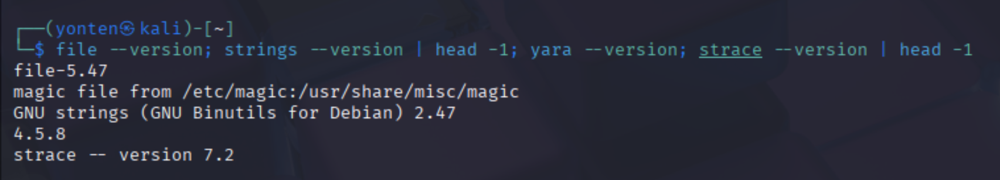
*Figure 1: Checking that all the tools are installed.*

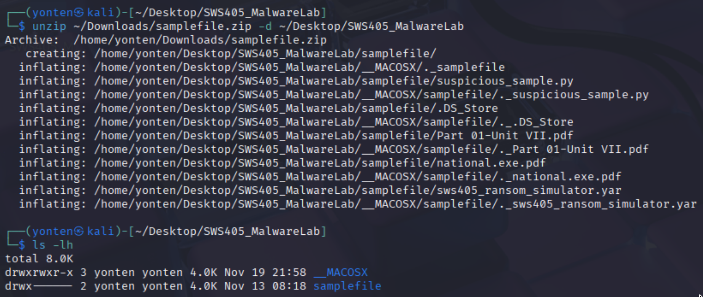
*Figure 2: Unzipping the lab files into the lab folder.*

---

## Part A: Static Analysis (without running it)

### 1. File type
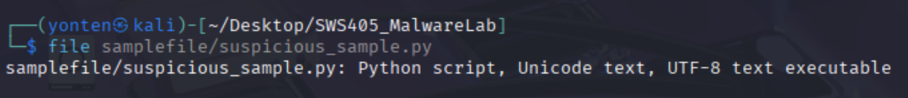
*Figure 3: `file` shows it's a Python script, not a Windows .exe.*

The `file` command reads the content, not just the name, so we know it really is a text-based Python script.

### 2. Hashing
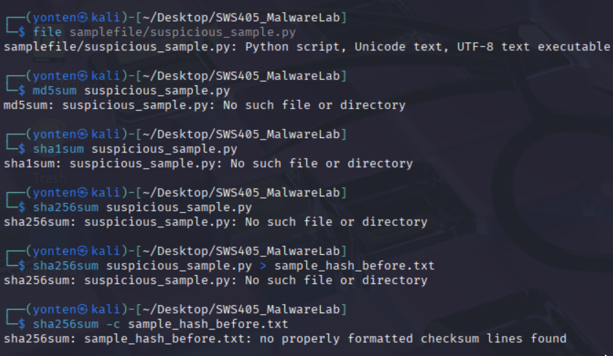
*Figure 4: The hash commands failed because I was in the wrong folder.*

I ran the hash commands from the parent folder, so they couldn't find the file and `sample_hash_before.txt` was saved empty. I took the SHA-256 again later from inside the right folder (Figure 17):

`7ef94bfb15c7479e209a701b40cf6994a2f9c4b0870b4576966b43050554bc26`

### 3. Strings
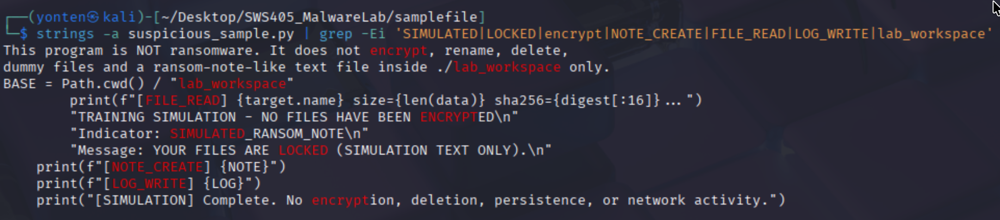
*Figure 5: Readable strings that hint at ransomware-like behaviour.*

Strings like `YOUR FILES ARE LOCKED`, `SIMULATED_RANSOM_NOTE`, `FILE_READ`, `NOTE_CREATE`, `LOG_WRITE` and `lab_workspace` suggest the program makes a folder, reads files, and drops a ransom note. At this point it's just a guess.

### 4. Hex view
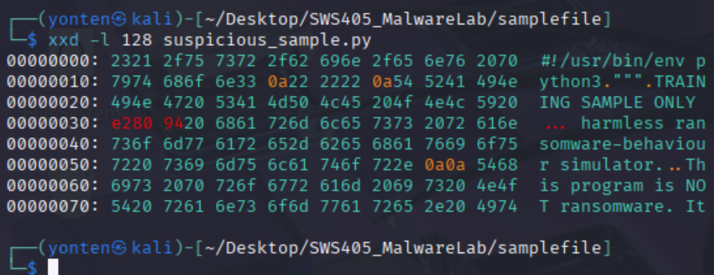
*Figure 6: The file starts with `#!/usr/bin/env python3`, not `MZ`.*

No `MZ` header means this isn't a Windows PE file. It's just a script.

### 5. YARA
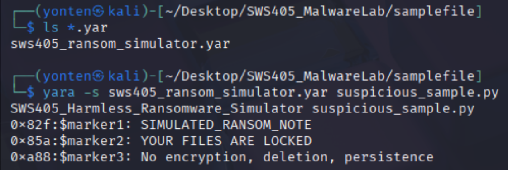
*Figure 7: YARA matched all three markers in the sample.*

The rule needs 2 of 3 markers and all 3 were found (`0x82f`, `0x85a`, `0xa88`).

### 6. Static analysis worksheet
| Question | What I saw | What it means |
|---|---|---|
| Real file type? | Python script, UTF-8 text | Not a Windows executable |
| SHA-256? | `7ef94bfb...4bc26` | Unique fingerprint of this file |
| Suspicious strings? | YOUR FILES ARE LOCKED, SIMULATED_RANSOM_NOTE, FILE_READ, NOTE_CREATE | Looks like ransomware behaviour |
| File operations suggested? | Create folder, create/read files, write note and log | Watch the file system when running it |
| YARA match? | Yes: marker1, marker2, marker3 | Known training sample |
| What to monitor? | Files and folders created, process, network | Check these in Part B |

---

## Part B: Dynamic Analysis (running it)

### B1. Baseline
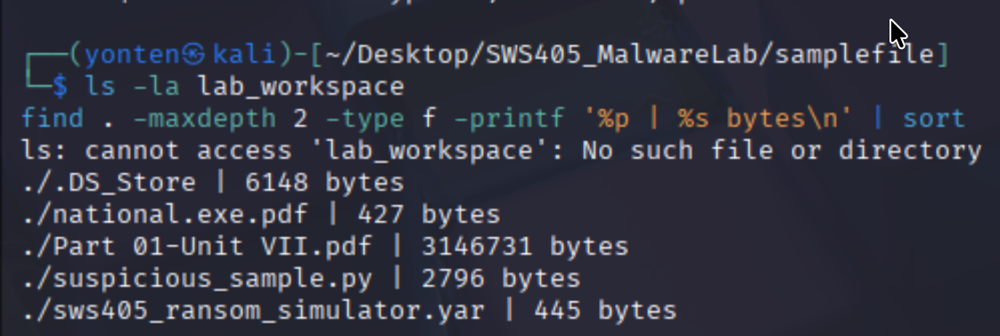
*Figure 8: Before running, there's no `lab_workspace` folder.*

### B2. Process monitor
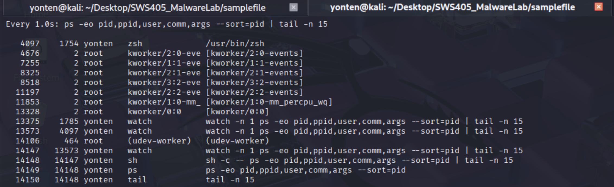
*Figure 9: Process list with `watch`. The sample ran too fast to show up.*

### B3. strace
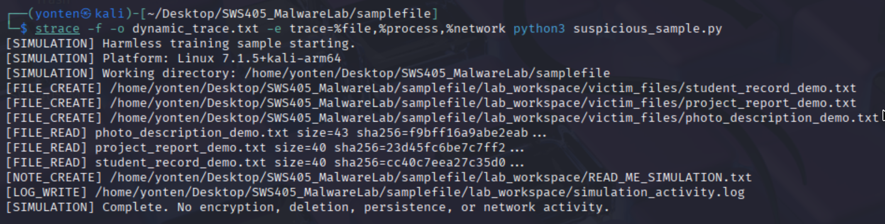
*Figure 10: Running the sample under strace creates files, reads them, and writes a note.*

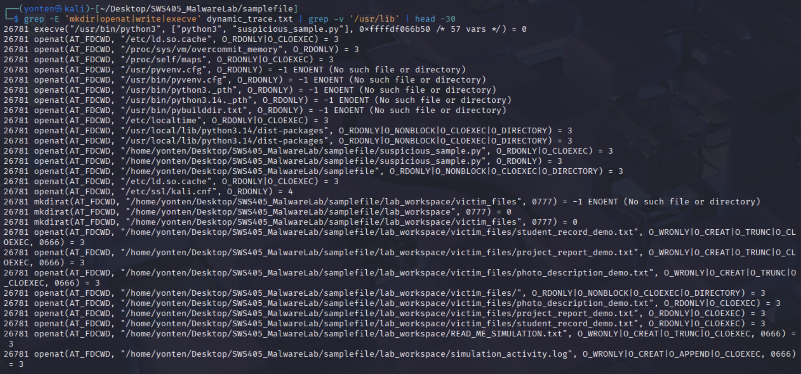
*Figure 11: System calls showing folder creation (`mkdirat`) and file create/read (`openat`).*

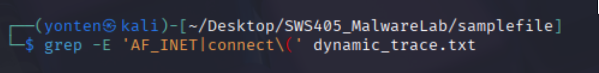
*Figure 12: No network calls found in the trace (empty output).*

### B4. Files created
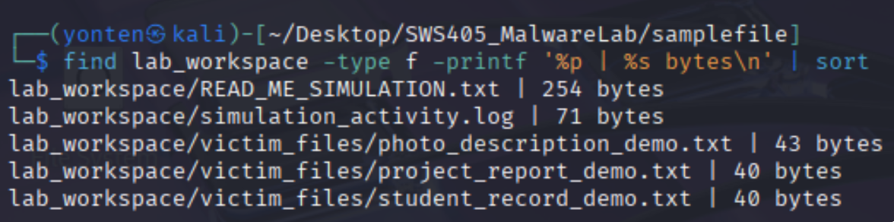
*Figure 13: Five new files inside `lab_workspace` after running.*

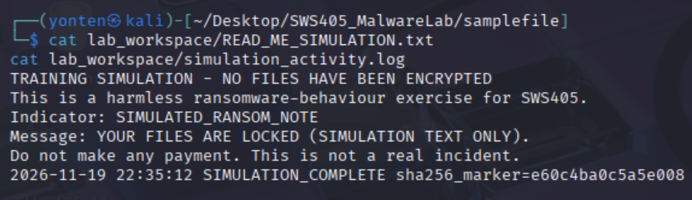
*Figure 14: The fake ransom note and activity log.*

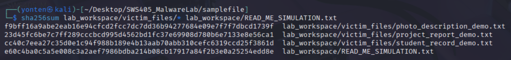
*Figure 15: SHA-256 hashes of the files the sample created.*

### B5. Network
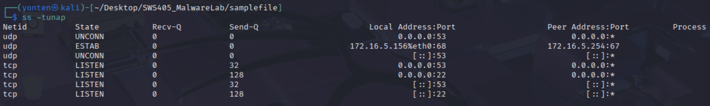
*Figure 16: Open sockets. Only normal system services, nothing from the sample.*

Only DNS (53), SSH (22) and DHCP (68) show up. These are normal Kali services, not Python.

### B6. Sample integrity
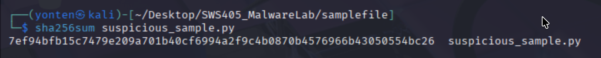
*Figure 17: SHA-256 of the sample after running.*

---

## Static vs Dynamic Findings
| Static guess | Dynamic evidence | Result |
|---|---|---|
| Strings mention `FILE_CREATE` and `lab_workspace` | `mkdirat` + `openat O_CREAT` in strace | Confirmed |
| Strings include `YOUR FILES ARE LOCKED` | The note has this text | Ransom note is only simulated |
| Code reads files | `openat O_RDONLY` on the 3 dummy files | Confirmed |
| No network expected | No `AF_INET`/`connect` in trace | No network seen |
| No encryption code | Files are plain text, the note says "NO FILES HAVE BEEN ENCRYPTED" | No encryption seen |

## IOCs (training only)
| Type | Value |
|---|---|
| Sample | `suspicious_sample.py` |
| File type | Python text script |
| SHA-256 | `7ef94bfb15c7479e209a701b40cf6994a2f9c4b0870b4576966b43050554bc26` |
| YARA rule hit | `SWS405_Harmless_Ransomware_Simulator` |
| Created folder | `./lab_workspace/victim_files/` |
| Ransom note | `./lab_workspace/READ_ME_SIMULATION.txt` (SHA-256 `e60c4ba0...edd8e`) |
| Log | `./lab_workspace/simulation_activity.log` |
| Network | None seen in this run |

---

## Practical Questions

**1. Why use `file` instead of trusting the extension?**

**Ans:** Anyone can rename a file. `file` checks what's actually inside, so a renamed `.exe` can't fool it.

**2. Filename vs hash?**

**Ans:** A filename is just a label and can change anytime. A hash comes from the file's content, so even a one-byte change gives a totally different hash.

**3. Which strings looked suspicious before running?**

**Ans:** `YOUR FILES ARE LOCKED`, `SIMULATED_RANSOM_NOTE`, `FILE_READ`, `NOTE_CREATE`, `LOG_WRITE` and `lab_workspace`.

**4. Why doesn't a YARA match prove a file is malicious?**

**Ans:** YARA only looks for text patterns. A harmless file (like a security article) can contain the same words, so we still need to check what it actually does.

**5. Which strace calls show file creation or access?**

**Ans:** `mkdirat` (made the folders), `openat` with `O_CREAT|O_WRONLY` (created the files), `openat` with `O_RDONLY` (read them), and `execve` (started Python).

**6. What changed between before and after?**
**Ans:** Before, there was no `lab_workspace`. After, it had 3 dummy files, a ransom note and a log file.

**7. Did it talk over the network?**

**Ans:** No. The grep for `AF_INET`/`connect` was empty, and `ss` only showed normal system services.

**8. One static guess confirmed by dynamic analysis?**

**Ans:** The strings showed `lab_workspace` and `FILE_CREATE`, and strace showed `mkdirat` creating that exact folder and files.

**9. Why revert the VM after the lab?**

**Ans:** To get rid of anything the sample left behind, so the next lab starts clean. With real malware it might hide changes we didn't notice.

---

## Limitations
- The A2 hashes failed because I was in the wrong folder (Figure 4), so there's no hash from before running. The SHA-256 was taken after running instead.
- The sample finished too fast to catch in the `watch` process list.
- It's a Python script, so PE headers, imports and Windows registry checks couldn't be tested here.
- This is only one run. Real malware can act differently depending on time, network or environment.

## Conclusion
From this lab, I learned the difference between static and dynamic malware analysis. Static analysis helped me identify suspicious signs without running the file, while dynamic analysis helped me understand what the file actually does. I learned that the sample only created dummy files, read them and generated a fake ransom note. It did not encrypt or delete any files or make network connections. Overall, I understood that we should not judge a file only by its appearance or suspicious strings. We need to analyse its actual behaviour to know whether it is harmful or not.

