# Lab 1: Beginner's Luck

### Challenge description

```
My sister's computer crashed. We were very fortunate to recover this memory dump. Your job is get all her important files from the system. From what we remember, we suddenly saw a black window pop up with something being executed. When the crash happened, she was trying to draw something. That's all we remember from the time of the crash.
```

### Setup

| Setup Item | Description |
|---|---|
| Volatility Version | Volatility 2.6.1 |
| System | Kali Linux (ARM) |
| Installation | Ran from source because the ready-made binary was incompatible. |
| Python | Python 2 |
| Dependency | Installed pycryptodome for hashdump. |
| Plugins | Cloned the community plugin pack. |
| Errors | distorm3 errors appeared but did not affect the plugins used. |

###  Investigation log

I ran `imageinfo`, then `pslist` and `pstree`.

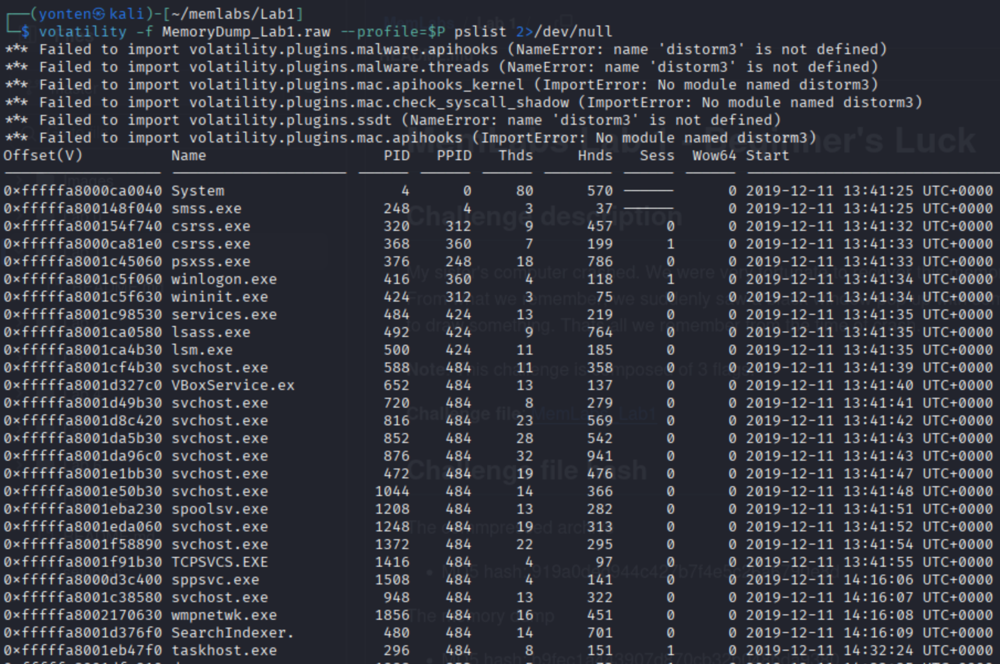
*Figure 1: pslist output*

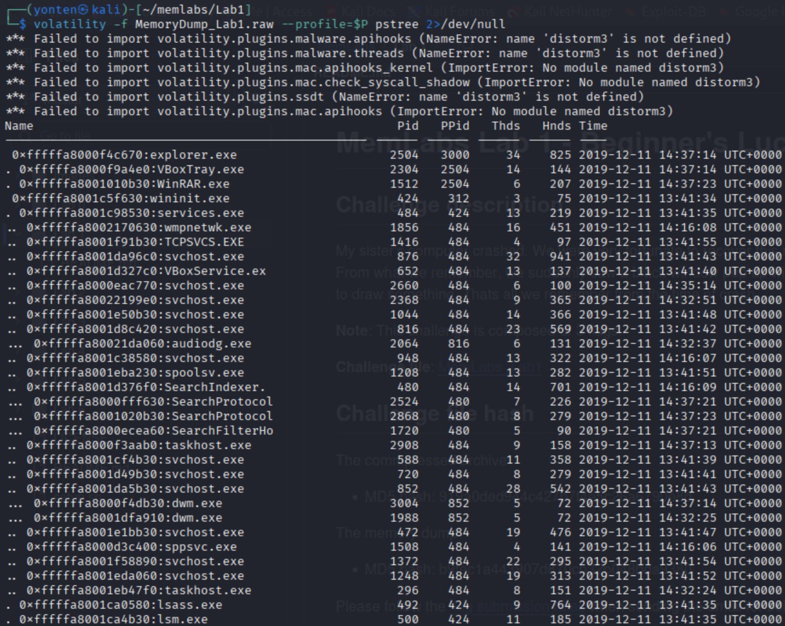
*Figure 2: pstree output.*

| Process | PID | What it tells me |
|---|---|---|
| cmd.exe | 1984 | The user opened a command window at 14:34:54. |
| mspaint.exe | 2424 | The user was drawing. This matches the story. |
| WinRAR.exe | 1512 | The archive manager. It was started from explorer.exe. |
| DumpIt.exe | 796 | The tool that made this dump. It started about 6 seconds before the capture, so it is not the user's work. |
| VBoxService / VBoxTray | 652 / 1844 | VirtualBox tools, so this was a virtual machine. |

### Command-line activity

I ran `cmdscan`.

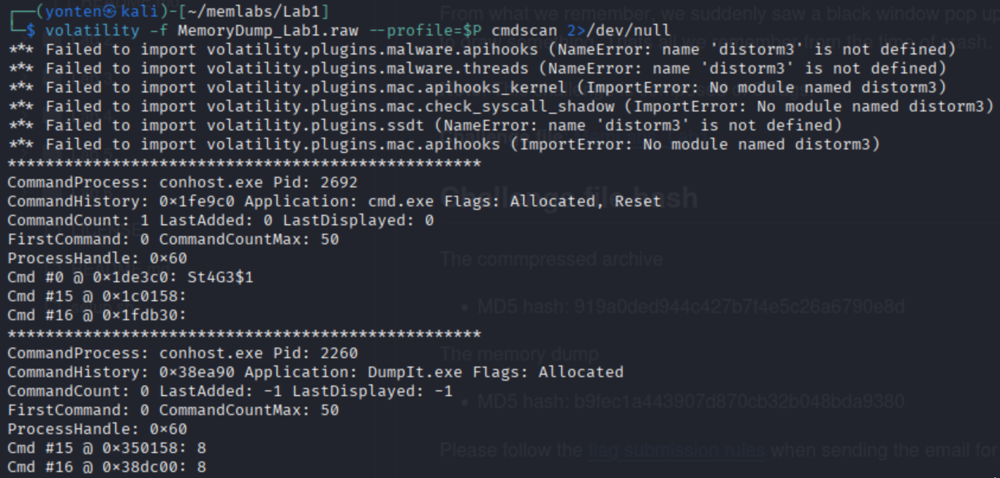
*Figure 3: cmdscan output*

Then I ran `consoles`.

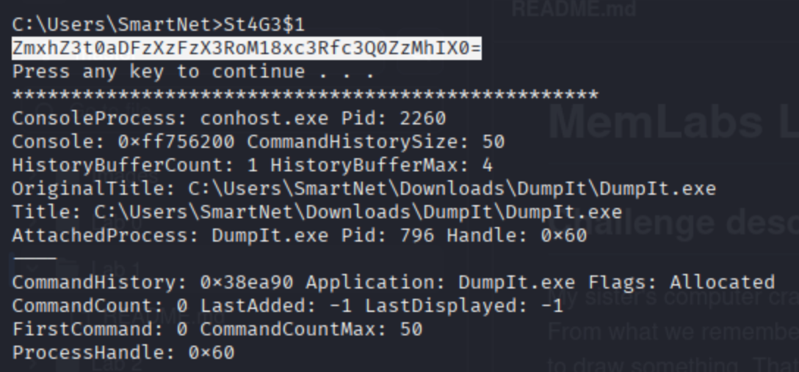
*Figure 4: consoles output.*

- PID 2692 (conhost.exe) shows the user ran `St4G3$1`, followed by unreadable output. DumpIt.exe (PID 2260) only shows its banner and dump destination, confirming it was used for memory acquisition, not user activity.

Then decoding the string that I got earlier with base64 gave me the first flag `flag{th1s_1s_th3_1st_st4g3!!}`

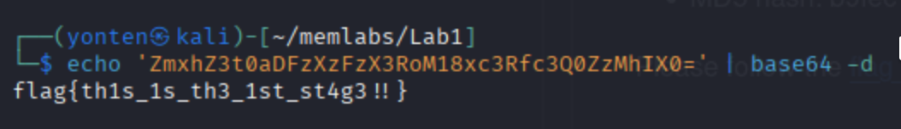
*Figure 5: first flag.*

**Why this tool worked:** `cmdscan` shows the commands typed, while `consoles` also shows the program's output stored in conhost.exe memory.

### The Archive WinRAR Had Open (Flag 2)

I ran `envars`.

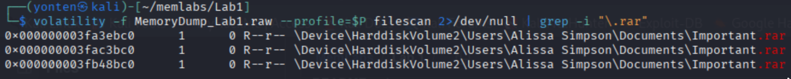
*Figure 6: filescan output filtered for .rar.*

I found `Important.rar` in `\Users\Alissa Simpson\Documents\`. It showed up three times. I used the first offset, `0x000000003fa3ebc0`.

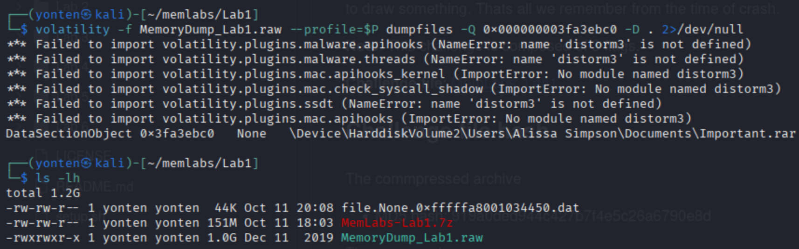
*Figure 7: dumpfiles output and the saved file.*

Renaming the `file.None.xx.dat` to `Important.rar`:

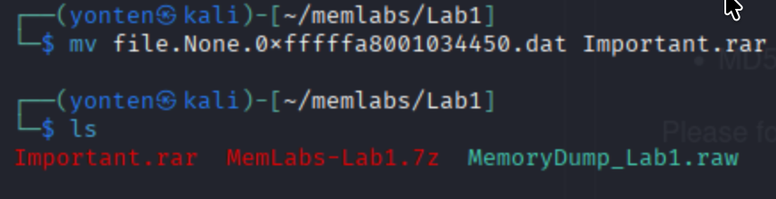
*Figure 8: renaming the file.*

Now trying to open the file, it asked for a password. The hint says that the password comes from Alissa's account password hash.

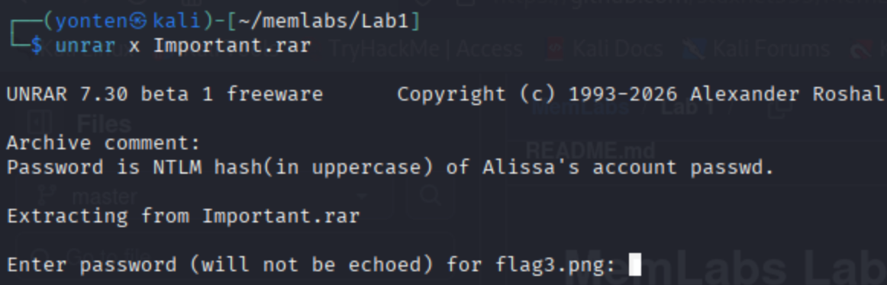
*Figure 9: the archive comment and the password prompt.*

From the raw file I extracted the hashed password.

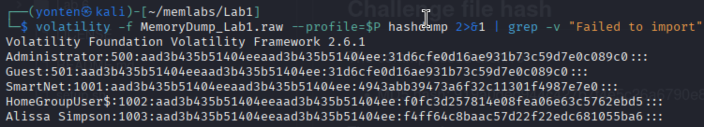
*Figure 10: hashdump output.*

Now I have the uppercase letters of the hashed password. But the password is only the second part:


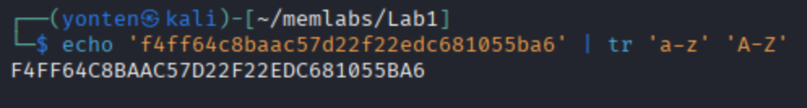
*Figure 11: converting the lower case to upper case letters*

The second flag has been successfully extracted.

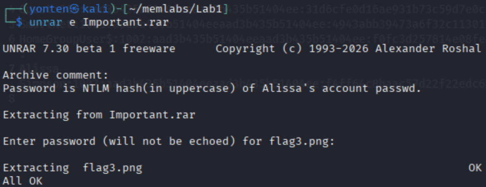
*Figure 12: successful extraction of flag3.png.*

**Flag 2:** `flag{w3ll_3rd_stage_was_easy}`

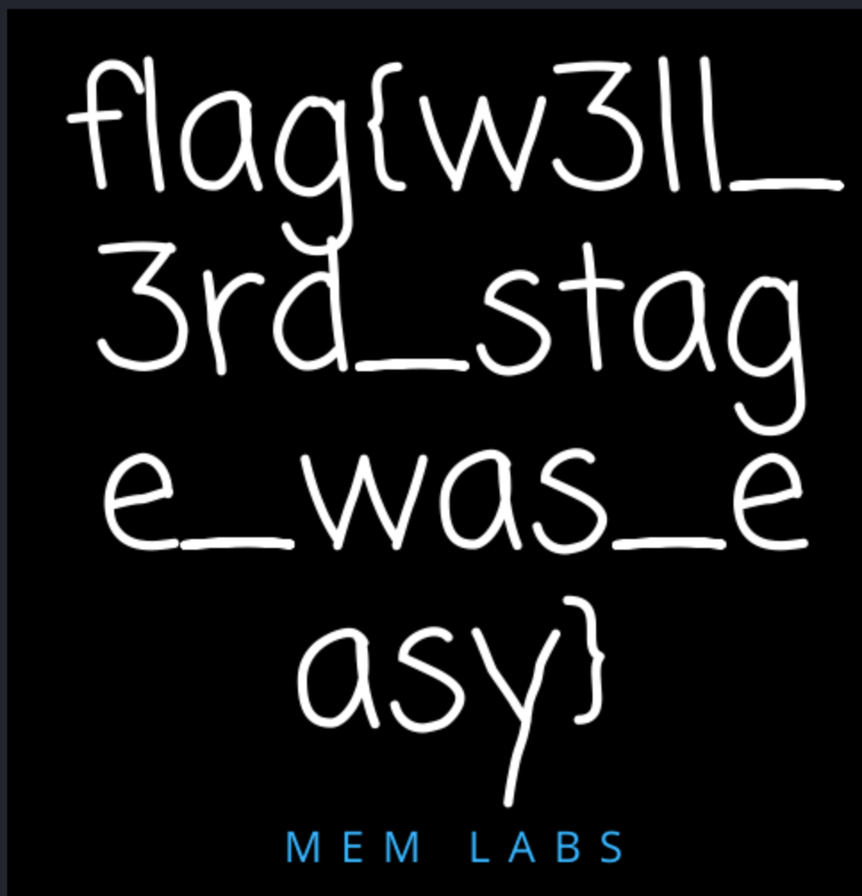

*Figure 13: the picture inside the archive.*

**Why this tool worked:** Windows stores account password hashes in the SAM and SYSTEM registry files. Those files are also loaded in memory. `hashdump` reads them from the memory dump and prints the hashes. So I got the key to the archive without ever knowing the real password.

###  The Drawing in Paint (Flag 3)

The story says she was drawing. The process list has mspaint.exe (PID 2424). It was started without any file name, so the drawing was never saved to disk. The only copy was in the memory of the process. Because of this, I dumped the process memory instead of looking for a file.

Dumping the process memory:

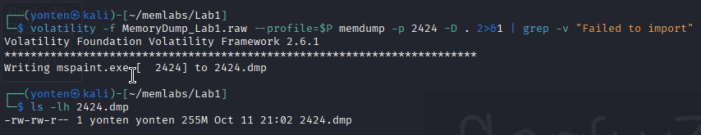
*Figure 14: memdump output and the file size.*

Here I found out that I can change the extension of the `.dmp` file to `.data` and open it with GIMP (GNU Image Manipulation Program) so that GIMP can open it as raw pixels.

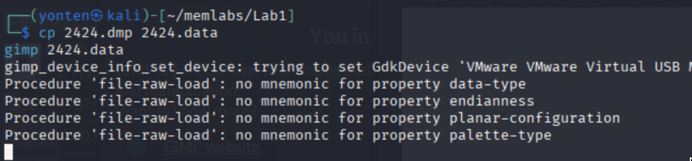

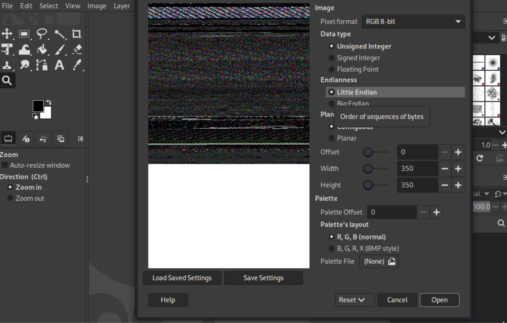
*Figure 15: GIMP raw import window.*

Ok, now I got the third flag by tuning the raw import settings.

third flag= `flag{Good_BoY_good_girL}`

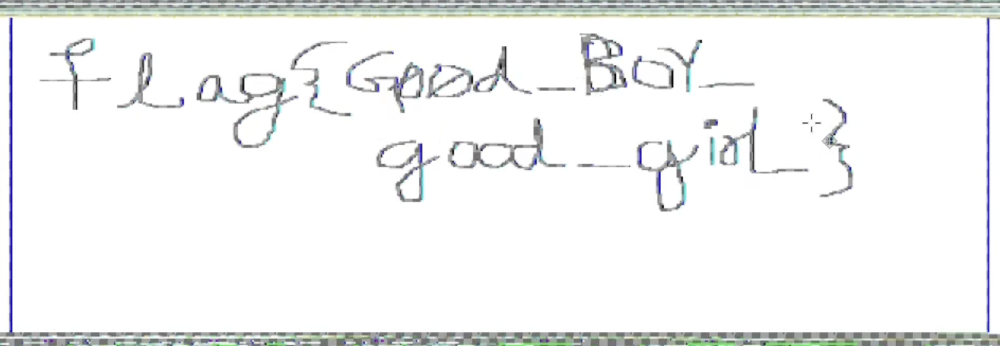
*Figure 16: Flag 3. The drawing recovered from the mspaint process memory.*


**Why this tool worked:** `memdump` saves everything a process had in RAM, including things that were never saved to disk. A bitmap is just rows of pixel bytes. So if I open the dump as raw pixels with the right width and offset, the picture appears.

### Flags

| Stage | Flag |
|---|---|
| Stage 1 | `flag{th1s_1s_th3_1st_st4g3!!}` |
| Stage 2 | `flag{w3ll_3rd_stage_was_easy}` |
| Stage 3 | `flag{Good_BoY_good_girL}` |


### Lab 1 Conclusion

From this lab, I found out that memory contains more information than just the applications that are in process. It is also able to store the results of the executed processes and passwords. It was necessary to use a different plugin for every flag, while at the same time each plugin was suitable. At the same time, `consoles` can extract the text that is shown, `hashdump` is used for registering the parts of memory, and `memdump` is good for saving the entire process. Additionally, I learned that even a failure, such as a failed search for the strings that I was looking for, can be a helpful result. In my case, it meant that the flag I obtained was an image.

---
---

# Lab 2: A New World

### Challenge description
```
One of the clients of our company, lost the access to his system due to an unknown error. He is supposedly a very popular "environmental" activist. As a part of the investigation, he told us that his go to applications are browsers, his password managers etc. We hope that you can dig into this memory dump and find his important stuff and give it back to us.
```

### Scope the Image

Find the profile:

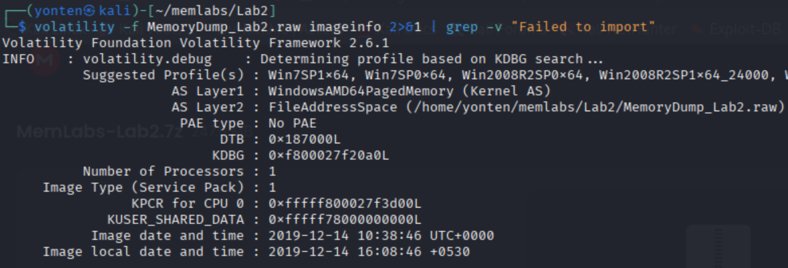
*Figure 1: imageinfo shows Windows 7 SP1 x64, so the profile is Win7SP1x64.*

`pslist` will now show the list of running programs when the memory was captured.

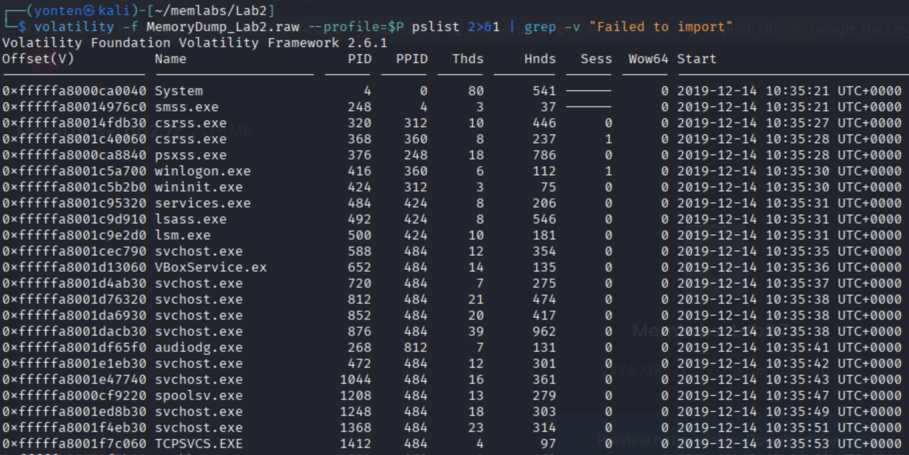

*Figure 2: pslist shows chrome.exe, KeePass.exe, cmd.exe, notepad.exe and DumpIt.exe.*

`pstree` will show the same processes grouped by parent.

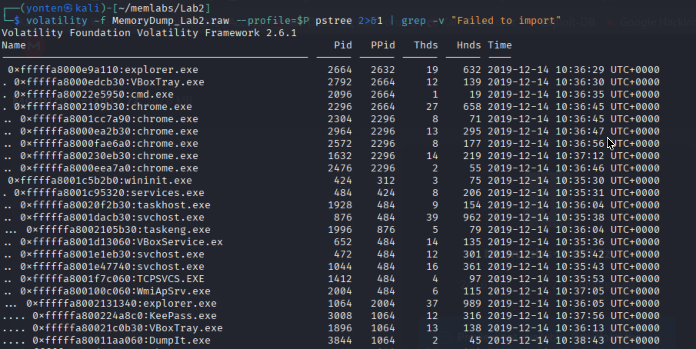
*Figure 3: pstree shows that chrome.exe and KeePass.exe were started by explorer.exe.*

From the above commands I found out that the memory profile is **Win7SP1x64**, along with running processes such as Chrome, KeePass, cmd.exe, Notepad, and DumpIt. The lab says two programs stand out: a browser and a password manager. This matches Chrome and KeePass.

### Environment Variables (Flag 1)

Now I will run `envars` to list the environment variables of every process. The hint says something encoded is hiding there.

I searched the environment variables for the TMP entries and found the same strange encoded value.

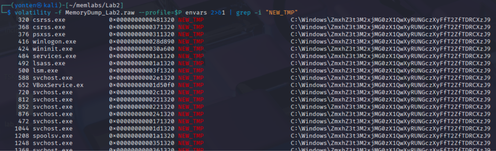
*Figure 4: envars output showing NEW_TMP*

The value ends in letters and numbers like Base64, and it starts with `Zmxh`, which decodes to "fla". Decoding it with base64 I got `flag{w3lc0m3_T0_$T4g3_!_Of_L4B_2}`

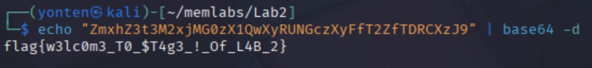
*Figure 5: Base64 value decoded.*

**Why this tool worked:** `envars` reads the environment variables stored in each process's memory. A program can hide data inside a variable with a normal-looking name. It found the hidden data in notepad.exe memory, which a normal file search would not find.

### KeePass (Flag 2)
I searched the files in memory for .kdbx, the KeePass database type. filescan found Hidden.kdbx in the user’s Secrets folder, at offset 0x000000003fb112a0. 
I then used dumpfiles with that offset to extract the file from memory.

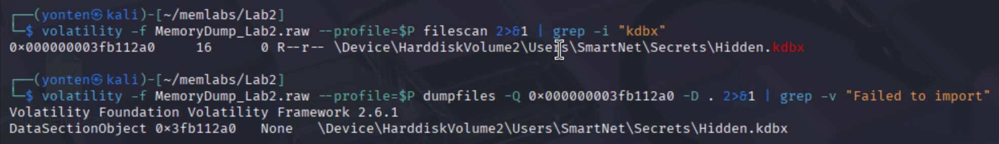
*Figure 6: finding and extracting the KeePass database.*


opening the database file with KeePass asked for a master password.
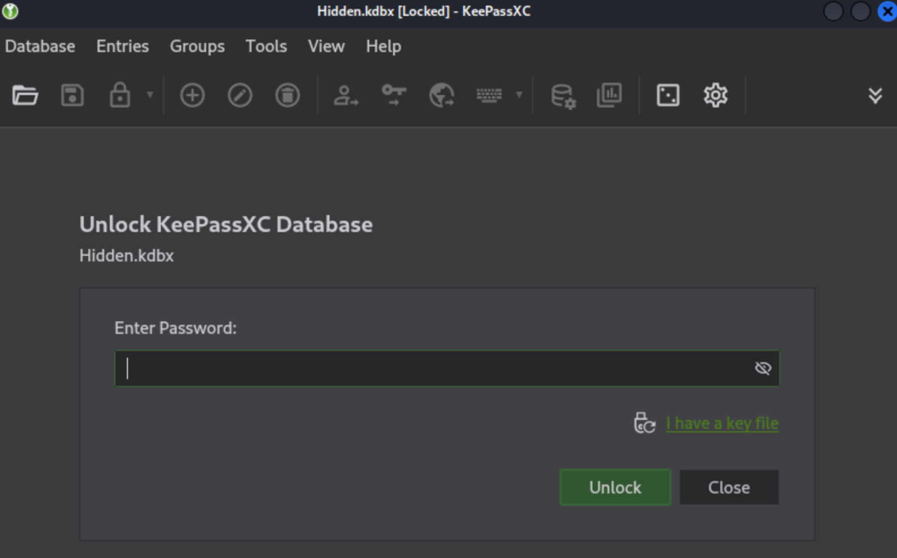
*Figure 7: KeePass database.*

### Find the master password
To find the password i first dumped the lists of hashes from the memory.
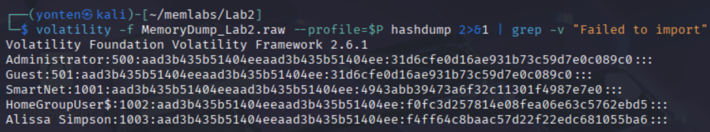
*Figure 8: hashdump output.*

I ran filescan on the full memory image and saved the output to filescan.txt, since the full list is too long to read directly.

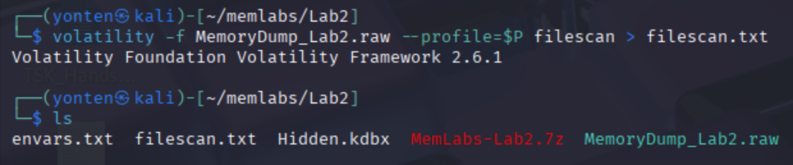
*Figure 9: running filescan and saving it to a file.*

I searched filescan.txt for files belonging to Alissa Simpson with grep -i "Alissa Simpson" filescan.txt.

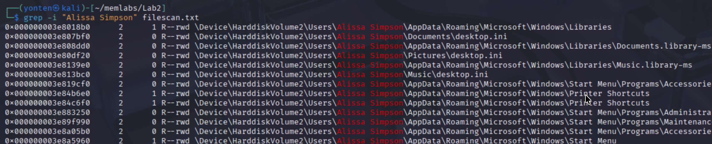

*Figure 10: searching files beloging to Alissa*

This found Password.png in her Pictures folder, at offset 0x000000003fce1c70, which looked like a strong lead for the KeePass master password.

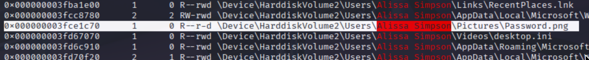
*Figure 11: searching the saved output for Alissa Simpson’s files*

Finally i found the password inside the image. the password is `P4SSw0rd_123`

*Figure 12: password for the database*


Navigating inside the Keepass database i found the flag inside the recycle bin. 
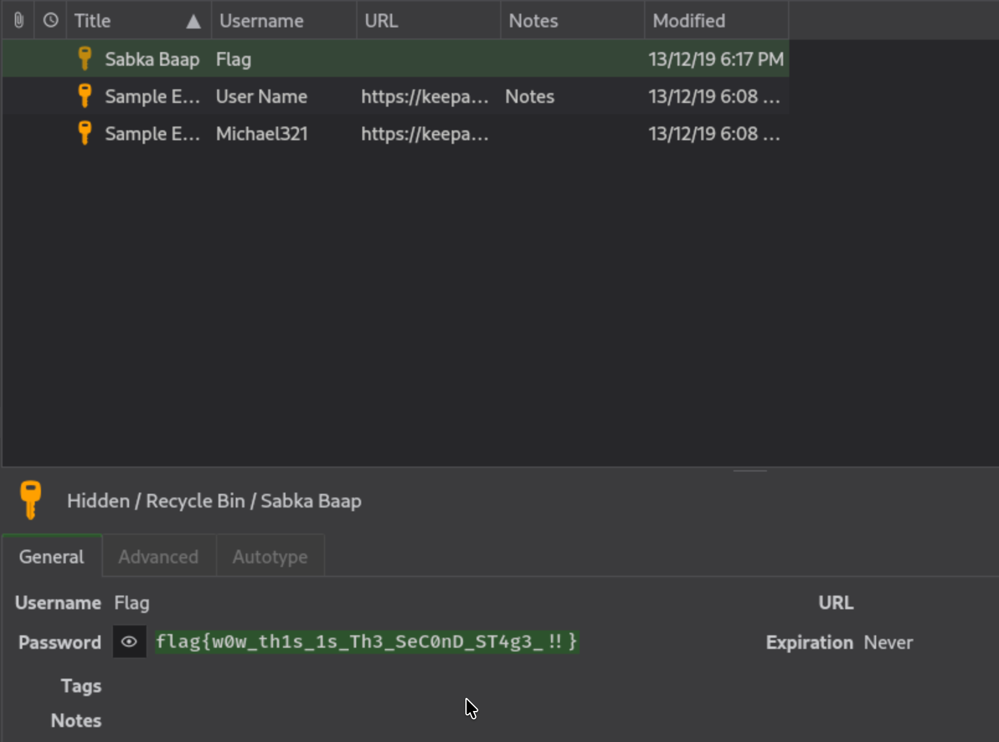

*Figure 13: flag found in Recycle Bin entry.*

The second flag is  `flag{w0w_th1s_1s_Th3_SeC0nD_ST4g3_!!}`


### Chrome browsing history (flag3)

I ran chromehistory using the community plugin pack. The output lists many URLs: news sites, blogs, and search engines, but only one file-sharing link, a Mega.nz folder at https://mega.nz/#F!TrgSQQTS!H0ZrUzF0B-ZKNM3y9E76lg

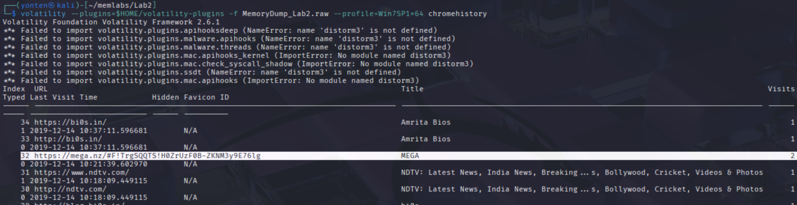
*Figure 14: chromehistory output showing a Mega link.*

At the link i found this Important.zip file.
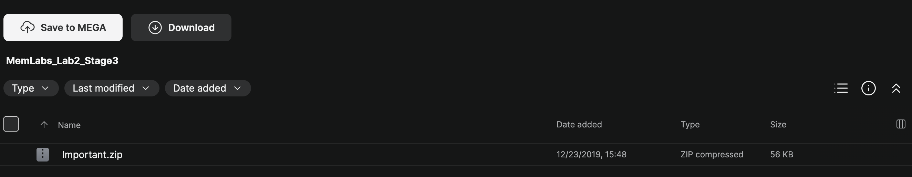
*Figure 15:  Mega link.*

After downloading the Imporant.zip file, I found out that it is locked with a password, and now I need a password to unzip it. The Hint says “Password is SHA1(stage-3-FLAG) from Lab-1. Password is in lowercase.”

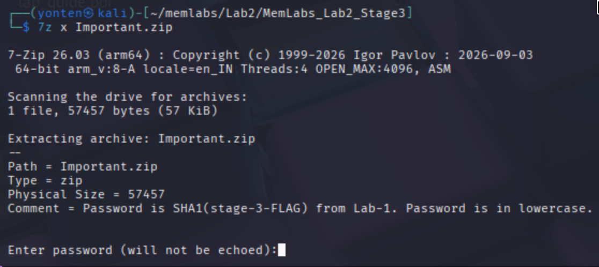
*Figure 16:  unzipping the important.zip file*

Now i will generate the SHA1 hash
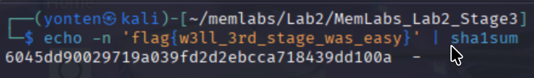
*Figure 17:  generating the sha 1 hash*

I have entered the SHA1 password hash and got the Important.png file which is the third flag.
`flag{oK_So_Now_St4g3_3_is_DoNE}`


*Figure 18:  The third flag*

### Flags

| Stage | Flag |
|---|---|
| Stage 1 | `flag{w3lc0m3_T0_$T4g3_!_Of_L4B_2}` |
| Stage 2 | `flag{w0w_th1s_1s_Th3_SeC0nD_ST4g3_!!}` |
| Stage 3 | `flag{oK_So_Now_St4g3_3_is_DoNE}` |

### Lab 2 Conclusion 
From this lab i found that the evidence can be hidden in different parts of memory, and each needs a different plugin to find it. I found the first flag using envars, recovered the KeePass database and its password from two files, and found the third flag through Chrome history and a Mega link. I also learned that clues from earlier labs can help solve new challenges. The main lesson is that small pieces of evidence can connect and lead to the final answer.

---
---


# Lab 3

### Challenge description
```
A malicious script encrypted a very secret piece of information I had on my system. Can you recover the information for me please?

Note-1: This challenge is composed of only 1 flag. The flag split into 2 parts.

Note-2: You'll need the first half of the flag to get the second.

The flag format for this lab is: inctf{s0me_l33t_Str1ng}
```
### Scope the image

First let's look for the profiles of the memory dump using imageinfo plugin. 

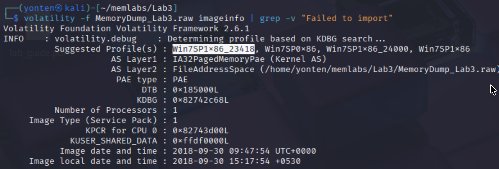
*Figure 1: imageinfo output showing suggested profile*

Output shows the profile as `Win7SP1x86_23418` and showed IA32PagedMemoryPae, which means this is a 32-bit Windows 7 image.


Then we check the processes using pslist plugin.It shows two notepad.exe processes (PID 3736 and 3432).

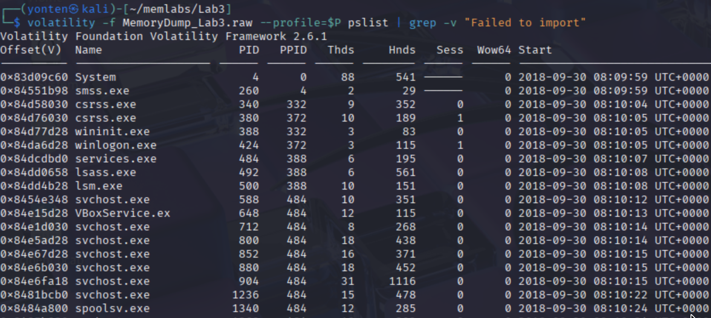
*Figure 2: pslist output showing two notepad.exe processes (PID 3736 and 3432)*


Two notepad.exe processes were opened one second apart, just seconds before the capture. DumpIt.exe is the tool that made the dump, so it is not the user's work.

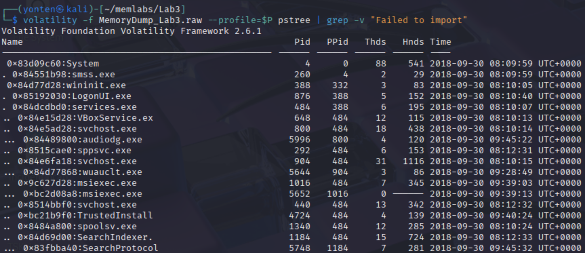
*Figure 3: check running processes with pstree plugin*

Both notepads were opened by the user from explorer.exe. Notepad is the only user application running, so it is the text editor the lab hint points to.


Then we check what files the two notepad processes had open using the cmdline plugin.

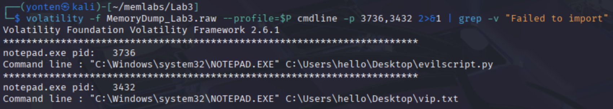
*Figure 4: cmdline output showing the files opened by each notepad.exe*

From the above output the PID 3736 opened `evilscript.py` and PID 3432 opened `vip.txt`, both on user hello's Desktop. 

Now let's find both files in memory

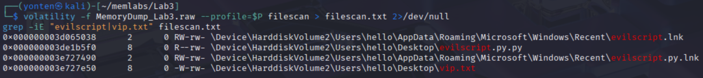
*Figure 5: filescan output showing evilscript.py.py and vip.txt on the Desktop*

The script is actually named `evilscript.py.py`, a double extension that Windows would show as `evilscript.py` with extensions hidden. The `.lnk` files in the Recent folder show the user opened the script recently.

### Extracting the files
Now let's dump both the files using their offsets.

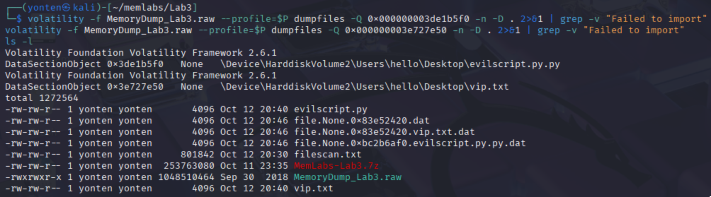
*Figure 6: dumpfiles extracting evilscript.py.py and vip.txt with original names*


I have recovered both the files from memory as 4096-byte `.dat` files.
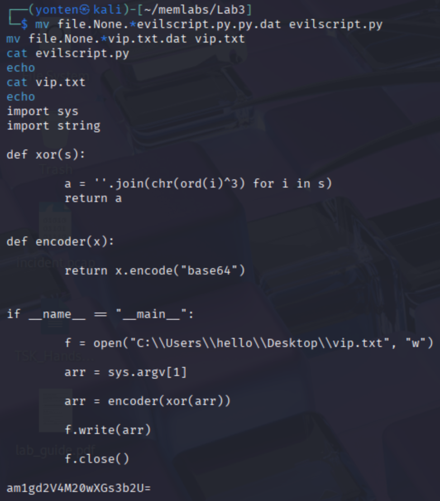
*Figure 7: contents of evilscript.py and vip.txt*

from the above output  i found out that `evilscript.py` is the malicious script and `vip.txt` holds its output, the base64 string `am1gd2V4M20wXGs3b2U=`.

### ## Reversing the script 
The script hides the secret in two steps. First it changes every letter using XOR with the number 3. Then it turns the result into base64 and saves it in vip.txt.

To get the secret back, I did the steps backwards. First I decoded the base64, then I XORed each letter with 3 again. Doing XOR with the same number twice gives back the original letter.
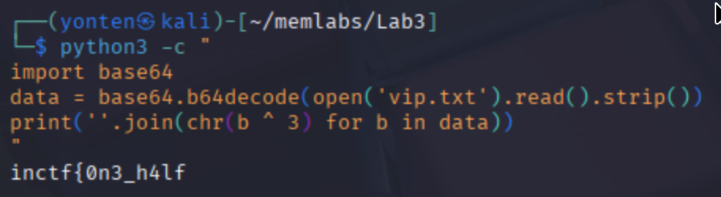
*Figure 8: reversing the script recovers the first half of the flag*

**First half of the flag** : `inctf{0n3_h4lf`

### Finding the hidden image (second half of the flag)
The lab hint says that steganography is used, so we searched the filescan output for image files.

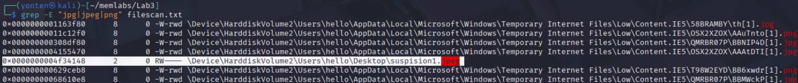
*Figure 9: filescan output filtered for image files*

Most images are Internet Explorer cache files, which is normal. `suspision1.jpeg` stands out because it is on the Desktop next to evilscript.py and vip.txt, and its name is "suspicious" misspelled.
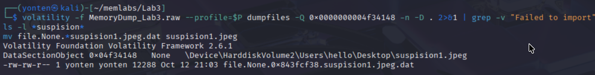
*Figure 10: dumping suspision1.jpeg from memory with dumpfiles*

ok now let's dig out the image using steghide tool. i used the passphrase as `inctf{0n3_h4lf` 

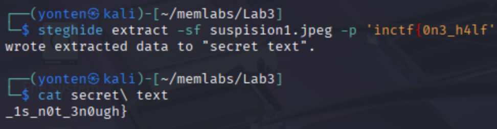
*Figure 11: first steghide attempt failed with the wrong passphrase*

Using steghide i got a file called secret text and inside that we found the second half of the flag `_1s_n0t_3n0ugh}`

### Flag 
`inctf{0n3_h4lf_1s_n0t_3n0ugh}`

### Lab 3 Conclusion
In this lab, cmdline was the key plugin. It showed which files the two notepad processes had open, which led straight to the script and its output. Reading the script let me reverse it by hand instead of guessing. The second half was hidden inside an image, which a normal file search would never show. This lab showed that one piece of evidence is often the key to the next one.


---
---

# Lab 4: Obsession
### Challenge description
```
My system was recently compromised. The Hacker stole a lot of information but he also deleted a very important file of mine. I have no idea on how to recover it. The only evidence we have, at this point of time is this memory dump. Please help me.

Note: This challenge is composed of only 1 flag.

The flag format for this lab is: inctf{s0me_l33t_Str1ng}
```


### Scope the Image

First we check the profile of the memory dump using the imageinfo plugin.

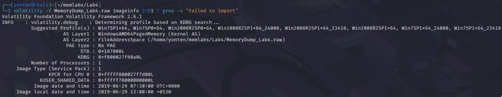
*Figure 1: imageinfo output showing suggested profile*

Output shows the profile as `Win7SP1x64` and WindowsAMD64PagedMemory.

Then we check the processes using pslist and pstree plugins.
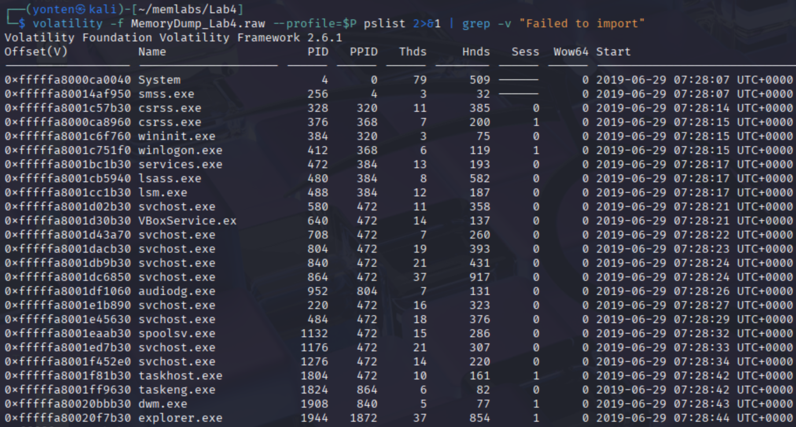
*Figure 2: pslist output showing two user sessions*

There are two user sessions. Session 2 started after DumpIt was already running, so a second user logged in before the capture.
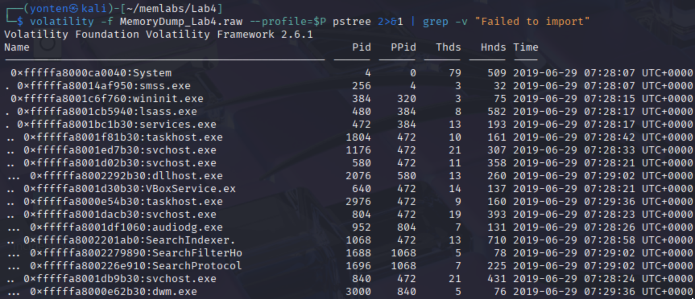
*Figure 3: pstree shows StikyNot.exe started by the second explorer.exe*


I only found this StikyNot.exe, and the evidence is more likely in files than in processes. The lab  also says to look at the Desktop.

#### Desktop files
We saved the filescan output and searched it for files on the Desktop.

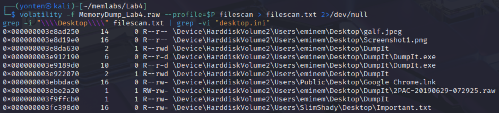
*Figure 4: filescan output showing files on the eminem and SlimShady Desktops*

From the output i found that there are two users, eminem and SlimShady. `galf.jpeg` ("flag" backwards) on eminem's Desktop looks suspicious, and `Important.txt` on SlimShady's Desktop looks important.


### Checking galf.jpeg
`galf.jpeg` looked suspicious, so I dumped it and checked it using the basic steganography tools.

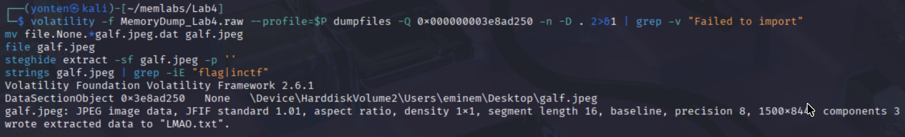
*Figure 5: dumping galf.jpeg and running steghide with an empty passphrase*

Steghide extracted a hidden file called `LMAO.txt` with no passphrase. strings found no flag text.

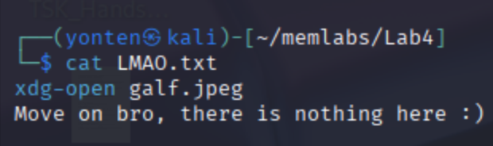
*Figure 6: LMAO.txt says "Move on bro, there is nothing here :)"*


*Figure 7: galf.jpeg shows a joker image*

The image is a distraction, but it still counts because it rules out the most obvious lead and shows why I moved on to Important.txt.

Next I tried to extract Important.txt the normal way with dumpfiles.


*Figure 8: dumpfiles finds Important.txt but writes no file*

dumpfiles printed the file path but saved nothing. The file still appears in filescan, but its content is no longer cached in memory because the file was deleted, so dumpfiles has nothing to copy.


### Recovering Important.txt from the MFT (Flag)

I parsed the NTFS Master File Table with mftparser, saved the output to a file and searched it for Important.txt.


*Figure 9: mftparser finds the MFT record for Important.txt*

The file content is stored inside its MFT record, split up by many line breaks (`0d 0a`). Joining the readable characters gives the flag.


*Figure 11: hex converted back to text with line breaks removed*

### Flag
`inctf{1_is_n0t_EQu4l_7o_2_bUt_th1s_d0s3nt_m4ke_s3ns3}`

#### Why dumpfiles failed but mftparser worked
dumpfiles could not recover Important.txt because its cached data was missing from memory. However, mftparser found the file's content inside its MFT record, which was still in memory even after deletion.

### Lab 4 Conclusion
In this lab, galf.jpeg was a false lead. Since Important.txt was deleted, dumpfiles could not recover it, but mftparser found its content. I learned that deleted files can still be recovered and that trying different plugins can help when one fails.

---
---


# Lab 5: Black Tuesday
### Challenge description
```
We received this memory dump from our client recently. Someone accessed his system when he was not there and he found some rather strange files being accessed. Find those files and they might be useful. I quote his exact statement,

The names were not readable. They were composed of alphabets and numbers but I wasn't able to make out what exactly it was.

Also, he noticed his most loved application that he always used crashed every time he ran it. Was it a virus?

Note-1: This challenge is composed of 3 flags. If you think 2nd flag is the end, it isn't!! :P

Note-2: There was a small mistake when making this challenge. If you find any string which has the string "L4B_3_D0n3!!" in it, please change it to "L4B_5_D0n3!!" and then proceed.

Note-3: You'll get the stage 2 flag only when you have the stage 1 flag.
```

### Scope the Image

first let's see the image info for the list of profiles.


*Figure 1: imageinfo output showing suggested profile*

The output shows the profile as `Win7SP1x64` and WindowsAMD64PagedMemory.

Then we check the processes using pslist and pstree plugins.

*Figure 2: pslist output showing WinRAR.exe (PID 2924)*


from the plist output WinRAR.exe (PID 2924) is the archive manager the lab mentions. There are also three uppercase NOTEPAD.EXE processes, each followed by a WerFault.exe crash, which is unusual.


*Figure 3: pstree shows WinRAR, notepad and DumpIt started by explorer.exe (PID 1580)*

All user programs were started from the second user session's explorer.exe.


Now let's find the archive WinRAR had open using the cmdline plugin.

*Figure 4: cmdline shows WinRAR opened SW1wb3J0YW50.rar*

The archive name `SW1wb3J0YW50` is base64 and decodes to "Important", so the file name was encoded to hide what it is.

### Extracting the archive
We dumped the archive from memory using dumpfiles and tried to open it.


*Figure 5: the archive contains Stage2.png and asks for a password*

The archive is password protected as said in the lab instructions so, I did not brute-force it.


### Browser history (Flag 1)

This system used Internet Explorer, so I used the built-in iehistory plugin instead of the community chromehistory plugin from Lab 2.


*Figure 6: iehistory output showing long base64 filenames ending in .bmp*

Most entries are normal websites and files, but two .bmp filenames are very long and start with `Zmxh`, which is base64 for "fla".


*Figure 7: decoding both filenames with base64*

Decoding that we got almost similar flags. One decodes to a Lab 3 flag (a decoy), and the other decodes to the Lab 5 flag.

first flag is `flag{!!_w3LL_d0n3_St4g3-1_0f_L4B_5_D0n3_!!}
`
### Opening the archive (Flag 2)

The lab says the first flag unlocks the archive, so I used it as the password.


*Figure 8: unrar extracts Stage2.png using Flag 1 as the password*


*Figure 9: Stage2.png showing the second flag*

Using the first flag as the password unlocked the archive, and Stage2.png inside it shows the second flag.

The second Flag is `flag{W1th_th1s_$taGe_2_1s_c0mPL3T3_!!}`

### Flags

| Stage | Flag |
|---|---|
| Stage 1 | `flag{!!_w3LL_d0n3_St4g3-1_0f_L4B_5_D0n3_!!}` |
| Stage 2 | `flag{W1th_th1s_$taGe_2_1s_c0mPL3T3_!!}` |


#### Why iehistory was the right plugin?
I used iehistory because the system used Internet Explorer, and this plugin can recover its history from memory. Unlike chromehistory, it works with Internet Explorer's history files.

### Lab 5 Conclusion

In this lab the process list only showed WinRAR and a locked archive, so I checked the browser history for more clues. I found out a long filename that contained a hidden flag. After decoding that i got two similar filenames, I found that one was a decoy and other was the first flag. The real flag unlocked the archive, which contained another flag. The main thing i got from this lab is that that even filenames can hide evidence and that every clue needs to be checked carefully.

