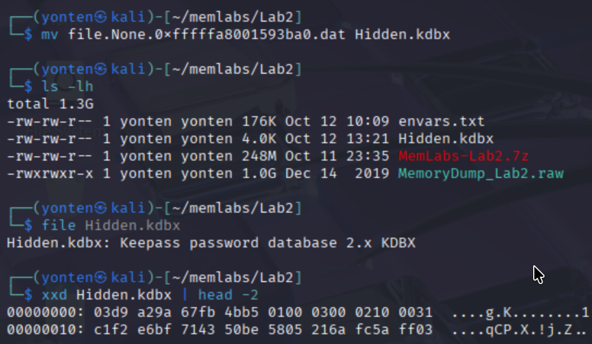

# Lab 1: Beginner's Luck

## 1. Challenge description

My sister's computer crashed. We were very fortunate to recover this memory dump. Your job is get all her important files from the system. From what we remember, we suddenly saw a black window pop up with something being executed. When the crash happened, she was trying to draw something. That's all we remember from the time of the crash.

## 2. Setup

| Setup Item | Description |
|---|---|
| Volatility Version | Volatility 2.6.1 |
| System | Kali Linux (ARM) |
| Installation | Ran from source because the ready-made binary was incompatible. |
| Python | Python 2 |
| Dependency | Installed pycryptodome for hashdump. |
| Plugins | Cloned the community plugin pack. |
| Errors | distorm3 errors appeared but did not affect the plugins used. |

## 3. Investigation log

### Step 1: Scope the image

I ran `imageinfo`, then `pslist` and `pstree`.


*Figure 1: pslist output*


*Figure 2: pstree output.*

| Process | PID | What it tells me |
|---|---|---|
| cmd.exe | 1984 | The user opened a command window at 14:34:54. |
| mspaint.exe | 2424 | The user was drawing. This matches the story. |
| WinRAR.exe | 1512 | The archive manager. It was started from explorer.exe. |
| DumpIt.exe | 796 | The tool that made this dump. It started about 6 seconds before the capture, so it is not the user's work. |
| VBoxService / VBoxTray | 652 / 1844 | VirtualBox tools, so this was a virtual machine. |

### Step 2: Command-line activity

I ran `cmdscan`.


*Figure 3: cmdscan output*

Then I ran `consoles`.


*Figure 4: consoles output.*

- PID 2692 (conhost.exe) shows the user ran `St4G3$1`, followed by unreadable output. DumpIt.exe (PID 2260) only shows its banner and dump destination, confirming it was used for memory acquisition, not user activity.

Then decoding the string that I got earlier with base64 gave me the first flag.


*Figure 5: decoded with base64 -d.*

**Why this tool worked:** `cmdscan` shows the commands typed, while `consoles` also shows the program's output stored in conhost.exe memory.

### Step 3: The Archive WinRAR Had Open (Flag 2)

I ran `envars`.


*Figure 6: filescan output filtered for .rar.*

I found `Important.rar` in `\Users\Alissa Simpson\Documents\`. It showed up three times. I used the first offset, `0x000000003fa3ebc0`.


*Figure 7: dumpfiles output and the saved file.*

Renaming the `file.None.xx.dat` to `Important.rar`:


*Figure 8: renaming the file.*

Now trying to open the file, it asked for a password. The hint says that the password comes from Alissa's account password hash.


*Figure 9: the archive comment and the password prompt.*

From the raw file I extracted the hashed password.


*Figure 10: hashdump output.*

Now I have the uppercase letters of the hashed password. But the password is only the second part:

```
F4FF64C8BAAC57D22F22EDC681055BA6
```


*Figure 11: converting the lower case to upper case letters*

The second flag has been successfully extracted.


*Figure 12: successful extraction of flag3.png.*

**Flag 2:** `flag{w3ll_3rd_stage_was_easy}`


*Figure 13: the picture inside the archive.*

**Why this tool worked:** Windows stores account password hashes in the SAM and SYSTEM registry files. Those files are also loaded in memory. `hashdump` reads them from the memory dump and prints the hashes. So I got the key to the archive without ever knowing the real password.

### Step 4: The Drawing in Paint (Flag 3)

The story says she was drawing. The process list has mspaint.exe (PID 2424). It was started without any file name, so the drawing was never saved to disk. The only copy was in the memory of the process. Because of this, I dumped the process memory instead of looking for a file.

Dumping the process memory:


*Figure 14: memdump output and the file size.*

Here I found out that I can change the extension of the `.dmp` file to `.data` and open it with GIMP (GNU Image Manipulation Program) so that GIMP can open it as raw pixels.


*Figure 15: GIMP raw import window.*

Ok, now I got the third flag by tuning the raw import settings.


*Figure 16: Flag 3. The drawing recovered from the mspaint process memory.*

**Why this tool worked:** `memdump` saves everything a process had in RAM, including things that were never saved to disk. A bitmap is just rows of pixel bytes. So if I open the dump as raw pixels with the right width and offset, the picture appears.

## Lab 1 Conclusion

From this lab, I found out that memory contains more information than just the applications that are in process. It is also able to store the results of the executed processes and passwords. It was necessary to use a different plugin for every flag, while at the same time each plugin was suitable. At the same time, `consoles` can extract the text that is shown, `hashdump` is used for registering the parts of memory, and `memdump` is good for saving the entire process. Additionally, I learned that even a failure, such as a failed search for the strings that I was looking for, can be a helpful result. In my case, it meant that the flag I obtained was an image.

---

# Lab 2: A New World

## Challenge description

One of the clients of our company, lost the access to his system due to an unknown error. He is supposedly a very popular "environmental" activist. As a part of the investigation, he told us that his go to applications are browsers, his password managers etc. We hope that you can dig into this memory dump and find his important stuff and give it back to us.

## Scope the Image

Find the profile:


*Figure 1: imageinfo shows Windows 7 SP1 x64, so the profile is Win7SP1x64.*

`pslist` will now show the list of running programs when the memory was captured.


*Figure 2: pslist shows chrome.exe, KeePass.exe, cmd.exe, notepad.exe and DumpIt.exe.*

`pstree` will show the same processes grouped by parent.


*Figure 3: pstree shows that chrome.exe and KeePass.exe were started by explorer.exe.*

From the above commands I found out that the memory profile is **Win7SP1x64**, along with running processes such as Chrome, KeePass, cmd.exe, Notepad, and DumpIt. The lab says two programs stand out: a browser and a password manager. This matches Chrome and KeePass.

## Environment Variables (Flag 1)

Now I will run `envars` to list the environment variables of every process. The hint says something encoded is hiding there.

I searched the environment variables for the TMP entries and found the same strange encoded value.


*Figure 4: envars output showing NEW_TMP*

The value ends in letters and numbers like Base64, and it starts with `Zmxh`, which decodes to "fla". Decoding it with base64 I got **`flag{w3lc0m3_T0_$T4g3_!_Of_L4B_2}`**


*Figure 5: Base64 value decoded.*

**Why this tool worked:** `envars` reads the environment variables stored in each process's memory. A program can hide data inside a variable with a normal-looking name. It found the hidden data in notepad.exe memory, which a normal file search would not find.

## KeePass (Flag 2)

I searched the files in memory for `.kdbx`, the KeePass database type. `filescan` found `Hidden.kdbx` in the user's Secrets folder, at offset `0x000000003fb112a0`. I then used `dumpfiles` with that offset to extract the file from memory.


*Figure 6: finding and extracting the KeePass database.*

`dumpfiles` saved the database with a generic name, so I renamed it to `Hidden.kdbx`. The `file` command says it is a KeePass 2.x database, and `xxd` shows the KeePass signature at the start. This shows the file came out of memory intact.


*Figure 7: renaming and checking the extracted file.*

### Find the master password

KeePass will ask for a master password, and the assignment says it won't be sitting next to the file. This one is just like Lab 1, where `hashdump` gave us the account hash that opened an archive. Here the database is also in the SmartNet user's folder, so start with that account.


*Figure 8: hashdump output.*
